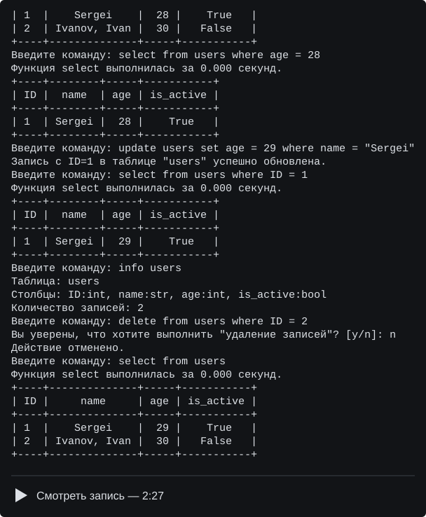

Домашнее задание №2. Примитивная база данных

Выполнено учеником М26-555 Кистиным Захаром.

Программа работает в терминале. В ней можно создать таблицу, добавить записи,
посмотреть их, изменить значения и удалить данные. Таблицы сохраняются в JSON,
поэтому после выхода из программы записи не пропадают.

Установка и запуск

Нужны Git, uv и Python 3.12 или новее. Git можно скачать с
[официального сайта](https://git-scm.com/install/windows).
Для установки uv в Windows нужно открыть PowerShell и выполнить:

powershell -ExecutionPolicy ByPass -c "irm https://astral.sh/uv/install.ps1 | iex"

После этого открыть новый терминал. Для других систем есть
[инструкция по установке uv](https://docs.astral.sh/uv/getting-started/installation/).
Дальше скачать проект и запустить программу:

git clone https://github.com/MarchiYT/project-2_Kistin_M26-555.git 
cd project-2_Kistin_M26-555 
uv python install 3.12 
uv sync --python 3.12 
uv run project

Если Python нужной версии ещё нет, uv скачает его. Зависимости устанавливаются
в папку .venv. Команда uv run database тоже запускает эту программу.
При следующем запуске достаточно перейти в папку проекта и выполнить uv run project.

Управление таблицами

Команды вводятся по одной после строки «Введите команду:».
Например, создадим таблицу пользователей и проверим, что она появилась:

create_table users name:str age:int is_active:bool 
list_tables

create_table создаёт таблицу, list_tables показывает все таблицы,
а drop_table users удаляет таблицу users вместе с её записями.
help выводит справку, exit завершает работу.

Есть три типа столбцов: int, str и bool. Имена таблиц и столбцов могут содержать
латинские буквы, цифры и подчёркивание. Регистр в именах учитывается.
Ключевые слова команд нужно писать маленькими буквами.

Столбец ID:int добавляется автоматически. При вставке записи ID указывать
не нужно: он равен наибольшему ID в таблице плюс один, а в пустой таблице — 1.
Изменять ID нельзя.

CRUD-операции

После создания таблицы можно выполнить такой пример:

insert into users values ("Sergei", 28, true) 
insert into users values ("Ivanov, Ivan", 30, false) 
select from users 
select from users where age = 28 
update users set age = 29 where name = "Sergei" 
select from users where ID = 1 
info users 
delete from users where ID = 2 
n 
delete from users where ID = 2 
y 
select from users 
drop_table users 
y 
exit

insert добавляет одну запись. Значения идут в том же порядке, что и столбцы
при создании таблицы. select показывает записи, update меняет их,
delete удаляет, а info выводит столбцы и количество записей.

Строки пишутся в одинарных или двойных кавычках, числа — без кавычек.
Для bool используются true и false в любом регистре. Типы проверяются:
например, "28" не подойдёт для столбца int. Пробелы и запятые внутри кавычек
сохраняются, поэтому "Ivanov, Ivan" считается одним значением.

В where можно задать одно условие с равенством. Обновление и удаление затрагивают
все записи, которые ему подходят. В set можно перечислить несколько изменений
через запятую, например: age = 29, is_active = false.

Перед delete и drop_table декоратор confirm_action спрашивает подтверждение.
Ответ y выполняет действие, любой другой ответ отменяет его. В примере сначала
отменяется удаление второй записи, затем подтверждается.

handle_db_errors выводит сообщение при ошибке, после чего можно ввести следующую
команду. log_time показывает время выполнения insert и select. Повторный select
с тем же условием использует кэш. После изменения данных кэш очищается.

Структура таблиц хранится в db_meta.json, записи — в папке data, по одному
JSON-файлу на таблицу. Эти файлы создаются в текущей папке терминала.
Чтобы продолжить работу с той же базой, нужно запускать программу из той же папки.

Код находится в src/primitive_db. main.py запускает приложение, engine.py
обрабатывает ввод, core.py выполняет операции с данными. В parser.py разбираются
команды, в utils.py читаются и сохраняются файлы. Декораторы и кэш находятся
в decorators.py, общие константы — в constants.py.

Проверка и сборка

uv run ruff check . 
uv build 
uvx twine check dist/*

Сборка создаёт архив и wheel в папке dist. Установить wheel отдельно от проекта
и запустить программу можно так:

uv tool install --python 3.12 dist/project_2_kistin_m26_555-0.1.0-py3-none-any.whl 
project

Если команда project не найдена, нужно выполнить uv tool update-shell
и открыть новый терминал.

При установленном Make можно пользоваться командами make install, make run,
make lint, make build и make check. Перед make check нужно выполнить make build.
Они выполняют те же действия, что и команды uv выше.

Запись работы

В записи показаны установка зависимостей, запуск, создание таблицы,
все CRUD-операции, отмена и подтверждение удаления, удаление таблицы и выход.
Чтобы посмотреть запись, нужно нажать на изображение.

Файл записи есть в репозитории: [demo.cast](demo.cast).
Его также можно открыть командой asciinema play demo.cast, если asciinema установлена.
